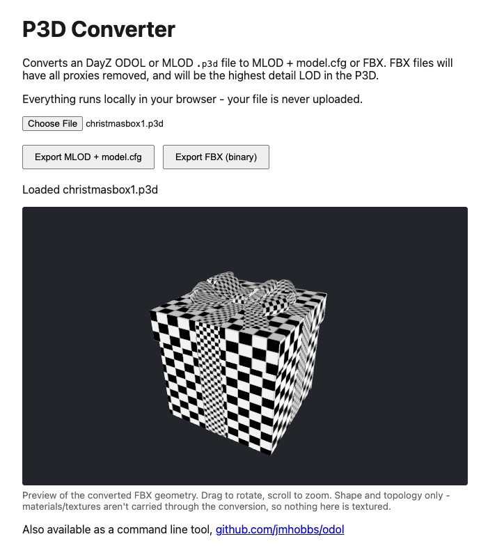

# ODOL

This repo contains tooling to convert Bohemia Interactive P3D files from ODOLv6 and ODOLv7 to MLOD format, or any P3D to FBX. It can also build an MLOD P3D from FBX files.

## Usage

### Web

The tool is available in your browser at [tools.dzhosts.com](https://tools.dzhosts.com/p3d-converter/). This is the easiest way to use it, and it should work on any platform.



Building a P3D from FBX files is available at [tools.dzhosts.com/fbx-to-p3d](https://tools.dzhosts.com/fbx-to-p3d/).

### CLI

If you'd like the tools locally, you can build them from source or get the latest release from [GitHub](https://github.com/jmhobbs/odol/releases)

#### odol-convert

`odol-convert` takes an input P3D file and emits an MLOD version and a model.cfg file to match.  Optionally, you can export the highest resolution LOD to FBX.

```
$ odol-convert
usage: odol-convert [--fbx] [--fbx-ascii] <input.p3d>
  -fbx
        export FBX instead of MLOD
  -fbx-ascii
        export ASCII FBX instead of binary (implies --fbx)

$ odol-convert m4a1.p3d
convert:        input P3D: m4a1.p3d
convert:      output MLOD: m4a1_mlod.p3d
convert: output model.cfg: m4a1.model.cfg

convert: detected input format: ODOLv6
convert: converting ODOLv6 to MLOD + model.cfg
convert: parsing ODOL data
convert: validating full decode
convert: writing output files
convert: conversion complete

$ odol-convert --fbx m4a1.p3d
convert:   input P3D: m4a1.p3d
convert:  output FBX: m4a1.fbx
convert: detected input format: ODOLv6
convert: converting ODOLv6 to FBX
convert: parsing ODOL data
convert: validating full decode
convert: writing FBX
convert: conversion complete

$ ls -lart
-rw-r--r--@   1 jmhobbs  staff   811824 Jul 15 10:58 m4a1.p3d
-rw-r--r--@   1 jmhobbs  staff  5861839 Jul 15 10:58 m4a1_mlod.p3d
-rw-r--r--@   1 jmhobbs  staff      680 Jul 15 10:58 m4a1.model.cfg
-rw-r--r--@   1 jmhobbs  staff  1461634 Jul 15 12:22 m4a1.fbx
```

#### fbx2p3d

`fbx2p3d` builds an MLOD P3D from binary FBX files, one file per resolution LOD. Pass each one as `--lod <resolution>=<path.fbx>`, and repeat the flag to add more LODs. Every resolution LOD gets a `camoground` named selection, and the tool generates Geometry, View Geometry, Fire Geometry and Memory LODs to fit the model.

Before it builds the P3D, it prints the model's size next to a reference human height and asks you to confirm it. If the model is the wrong size because of a unit mismatch in the FBX, run it again with `--scale`. Pass `-y` to skip the prompt.

```
$ fbx2p3d
error: at least one --lod is required
usage: fbx2p3d --lod <resolution>=<path.fbx> [--lod ...] [--texture <path.paa>] [--material <path.rvmat>] [--fire-material <name>] [--scale <factor>] [-y] [-o output.p3d]
  -fire-material string
    	vanilla penetration material applied to the Fire Geometry LOD, by name (e.g. wood, metalplate) or full DZ\data\data\penetration path; valid names are listed below
  -lod value
    	graphical LOD as <resolution>=<path.fbx>; repeatable, at least one required
  -mass float
    	total Geometry LOD mass in kg, split evenly across its 8 points (default 1)
  -material string
    	material .rvmat path applied to every graphical LOD (default: none)
  -o string
    	output P3D path (default: derived from the lowest-resolution --lod file)
  -scale float
    	uniform correction factor applied to every imported LOD's vertex positions, to fix a real-world unit mismatch from the source FBX (default 1)
  -texture string
    	texture .paa path applied to every graphical LOD (default: none)
  -y	skip the size-preview confirmation prompt (also auto-skipped when stdin is not a terminal)
  -yes
    	long form of -y

valid --fire-material names:
  armor_11mm_plate, armor_16mm_plate, armor_1mm_plate, armor_23mm_plate,
  armor_30mm_plate, armor_3mm_plate, armor_5mm_plate, armor_7mm_plate, armour,
  bricks, castiron, castironplate, cloth, concrete, coniferfoliage, cushion,
  dirt, explosiontransparent, fabric_thin, fabricp, foliage, foliage_green,
  glass, glass_armored, glass_house, glass_impenetrable, glassplate, granite,
  hay, ice, iron, ironplate, leather, mattress, meat, meatbones, metalplate,
  metalplatefence, plastic, plastic_material, plexiplate, pottery, rubber,
  rubberplate, snow, thin_wire, weaponlift, wood, wood_desk

$ fbx2p3d --lod 1=sodacan.fbx
fbx2p3d: importing LOD 1 from sodacan.fbx
fbx2p3d: preview: sodacan.fbx bounding box (X,Y,Z) = 0.0006m x 0.0012m x 0.0006m
fbx2p3d: preview: height 0.0012m is 0.00x the reference human height (1.7976m, measured from the male player model)
fbx2p3d: continue with this scale? [y/N] n
fbx2p3d: cancelled by user

$ fbx2p3d --lod 1=sodacan.fbx --scale 100 --fire-material metalplate -y
fbx2p3d: importing LOD 1 from sodacan.fbx
fbx2p3d: preview: sodacan.fbx bounding box (X,Y,Z) = 0.0638m x 0.1226m x 0.0638m
fbx2p3d: preview: height 0.1226m is 0.07x the reference human height (1.7976m, measured from the male player model)
fbx2p3d: building auxiliary LODs (Geometry, View Geometry, Fire Geometry, Memory)
fbx2p3d: writing sodacan.p3d
fbx2p3d: conversion complete
```

## Contributing

Find a bug? I'm not surprised. This is clanker code, generated from BI wiki docs and lots of sample files.  File an issue and send me your input file and we will see what can be done about it, but I wouldn't go reading the code if I was you.
